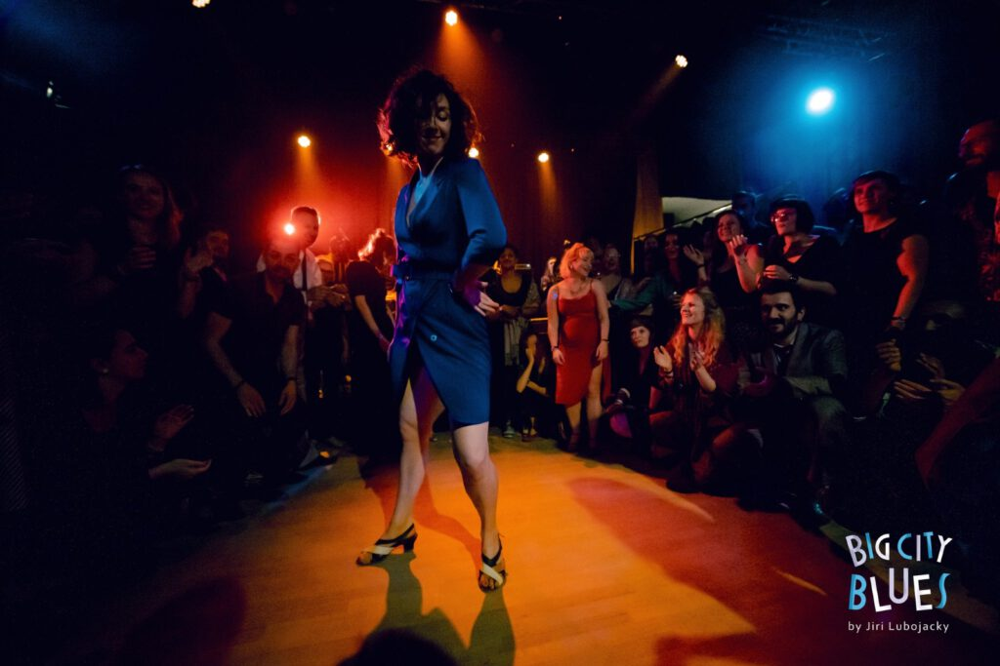

YES!! Finally we can announce that from coming block on, we are expanding our class offerings beyond the Lindy Hop alone. With teacher Renske joining the Lindy What? Lindy Hop Nijmegen fold, we will now also offer both Blues ánd Solo Jazz classes going forward!😍

## About vernacular Solo Jazz

If you thought Lindy Hop was fun, you haven’t tried solo jazz yet! 😉 Many of you will know the Shim Sham, might have learned the Tranky Doo or even tried the Big Apple. Routines danced for many years world wide. But there is way more to it! Diving into the jazz steps, rhythms and ways to use your body on your own you’ll discover the freedom solo jazz gives you, allowing you to improvise on the dance floor, just reacting to the music you hear.



### [More info and sign up form here!](/lindy-hop-lessons/#SoloJazz)

## About Blues dancing

Blues is an easy going dance full of groove, improvisation and musicality. Originated in the African American culture, it all started in the juke joints dancing the night away. The blues music is rich in its diversity. Going from the Delta & Mississippi blues, to Chicago blues into the jazzy New Orleans Blues, there are many blues idioms to be discovered along with it!



### [More info and sign up form here!](/lindy-hop-lessons/#Blues)

## About Renske

Renske has a heart made for dancing. She started when she was 3 years old and never stopped ; ) She might have tried almost every dance style there is, but the deep love for Blues, solo jazz and the swing dances stayed with her. In her classes she loves to spread her joy for dancing, diving into how to use your body, becoming aware of what you are doing and discovering together who you are as a dancer. Be ready to get a boost of energy in her classes!

