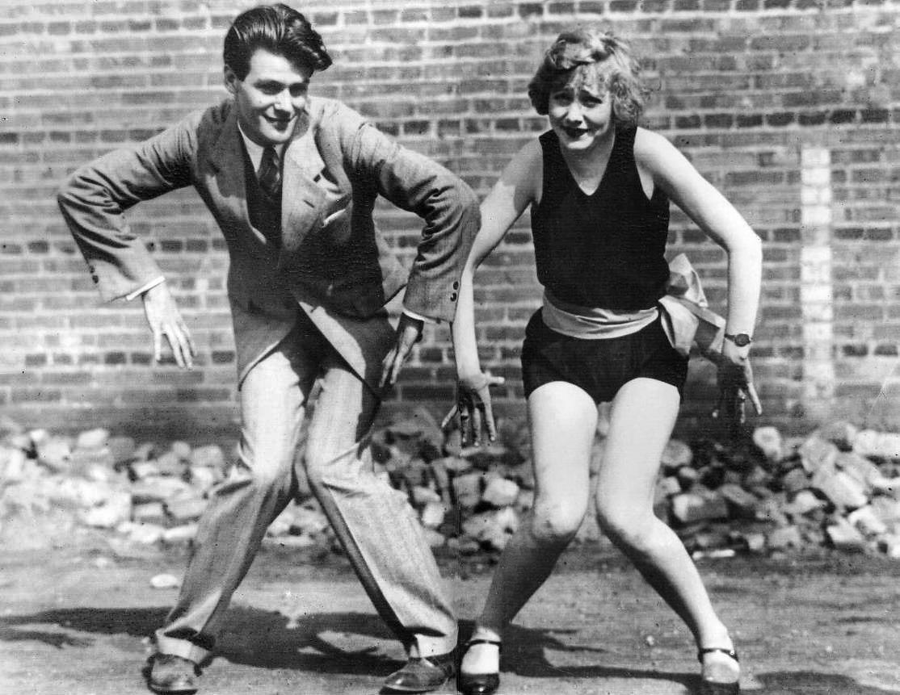

When you’re talking about Lindy Hop and Swing dances in general. The Charleston is probably the first dance you’ll hear about.

Named after the city of Charleston in South Carolina, the dance was popularized by a 1923 tune bearing the same name, composed by James Johnson. The absolute height of its popularity was reached around 1927.

Even though the Charleston had some typical characteristics of a traditional African American dance, The Johnson track originated in the Broadway show Runnin’ Wild, and besides specific movements like the “Jay-Bird”, there is actually no proof that the Charleston itself was ever performed on the plantations. Folklorist Harold Courlander even went as far as calling it “a synthetic creation, a newly-devised conglomerate tailored for widespread popular appeal.”

The typical beat was inspired from a clave rhythm heard in the Habanera and the Spanish Tinge.

In the 1930s, the Charleston transformed to fit the timing of the swing jazz of the era and was integrated in the then popular Lindy Hop. Although this form had many names, from Lindy Charleston to Swinging Charleston or even Savoy Charleston, the Savoy dancers considered themselves to be just incorperating Charleston steps into Lindy Hop.

Still today, this dance is very closely connected to dancing Lindy Hop, and you’ll see it on the social floor all around, either partnered or solo.

Staying true to the original Savoy dancers vision, we ourselves like to integrate Charleston lessons into the regular Lindy Hop courses. Sometimes however, Lindy What? Lindy Hop Nijmegen also organizes specific workshops!

