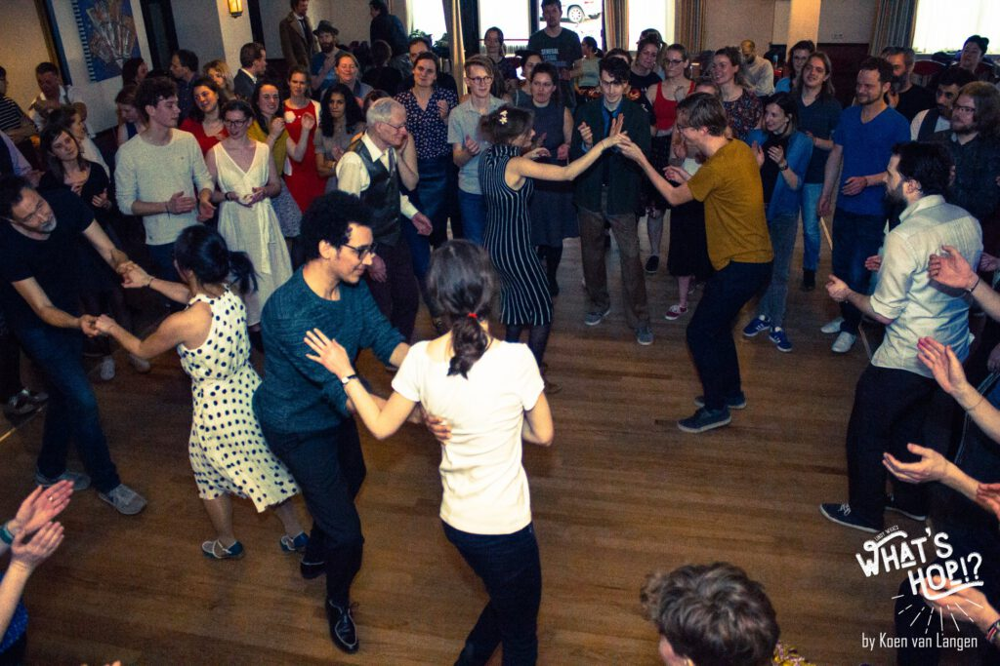

Lindy Hop is a street dance, and a social dance, so it’s only natural that the main focus of Lindy What?! is organizing social dances. Our main event is our monthly Sunday Tea Dance, aptly named NimmaHop! Dancers from all over Nijmegen, the Netherlands in general and beyond join us at [Salsa Tipica](https://maps.app.goo.gl/vDsCATgwyvHjSbUv5) for some informal dancing in a laid back atmosphere. Every 2nd Sunday of the month!

[Check out our event calendar for the next NimmaHop!](/agenda/)

## Live music

One of the best things to swing dance to is live music, as it creates a whole new dimension of interacting with not only your dance partner, but also with the band! It’s because of this that whenever we’re able, we try to have a band to provide their swingin’ tunes! Bands such as [The Kalishnikovs](https://www.facebook.com/Kalishnikovs/) and of course our resident Lindy Hop band [Celebrity Hottub party](https://www.youtube.com/watch?v=0gCTrjBaqo8) have visited in the past and we’re constantly looking for new groups!

## DJs

To make sure we don’t lose our bounce, our DJ’s are always at the ready to play your favorite tracks, be it for lindy hop, balboa, blues, slowbal or shag! We are always looking for additions to our team, so if you want to share your tunes with us, let us know!

