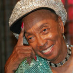

Tegen de tijd dat de [Savoy ballroom](http://en.wikipedia.org/wiki/Savoy_Ballroom) haar deuren sloot in 1958, waren de muzikale stromingen en dans cultuur dermate veranderd dat ook de Lindy Hop langzaamaan wegzakte in obscuriteit, zoals ook de dansen waaruit de Lindy Hop uit ontstond. Door een serie toevalligheden echter, stuit een aantal Zweedse, Amerikaanse en Britse swing dansers in de vroege jaren tachtig op oud beeldmateriaal van de Savoy en wilden hier meer van weten.

Hiervoor bezochten ze New York om een aantal van deze invloedrijke dansers uit het Gouden Tijdperk op te zoeken, waaronder Frankie Manning en Al Minns. Al Minns stierf helaas in 1985, maar Frankie heeft de laatste 25 jaar van z’n leven de wereld rondgereisd om z’n liefde voor de dans te verspreiden.

Dit is echter niet de plek om zijn hele verhaal te vertellen, hiervoor verwijzen je dan ook graag naar [Frankie’s autobiografie](http://www.frankiemanning.com/book.php). Ook kunnen we [Norma Miller’s boek](http://www.amazon.com/Swinging-Savoy-Memoir-Jazz-Dancer/dp/1566398495) aanbevelen voor een fascinerende en mooie herinnering van deze tijden. Hier is het ook belangrijk te vernoemen dat, hoewel Frankie Manning een enorme rol heeft gespeeld in zowel de gouden jaren als gedurende de revival, Frankie niet de belichaming zelf is van Lindy Hop, maar door toevalligheden het absolute icoon werd. In werkelijkheid was hij onderdeel van een veel grotere groep dansers die, mede door het fanatieke racisme uit die tijd, helaas nooit het platform hebben gekregen die ze verdienen.

---

Een aantal van de Zweedse dansers die Al en Frankie opzochten vormden de een Lindy Hop performance groep de [Rhythm Hot Shots](http://www.rhythmhotshots.com/) genaamd (waarvan de originele leden Anders Lind, Ewa Staremo, Lennart Westerlund, Catrine Ljunggren, Eddie Jansson en Eva Lagerkvist waren; later voegde ook Ewa Burak zich hierbij). Hier zie je een aantal van hen in actie (Catrine introduceert de groep daar zij destijds geblesseerd was; Anders had hier de groep al verlaten waardoor je David Dalmo met Ulrika Ericsson ziet dansen).:



---

Ter ere van Frankie’s 95e verjaardag in 2009 imiteerden een aantal top Lindy Hoppers de beroemde dans scene uit de 1942 film Hellzapoppin’:



---

Spijtig genoeg verloren we Frankie in 2009 op 95e leeftijd, maar putten we tot op de dag van vandaag inspiratie uit het feit dat hij tot het eind van z’n leven heeft gedanst en Lindy Hop heeft gedoceerd. Hier is hij 91:



Dank aan Simon Brain voor de originele teksten.
