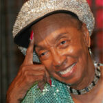

By the time the [Savoy ballroom](http://en.wikipedia.org/wiki/Savoy_Ballroom) closed its doors in 1958, changes in musical and dance culture meant that the Lindy Hop had started to fade into obscurity in terms as general popularity, just as had the dances from which the Lindy Hop had grown.

However, Lindy Hop and variations of swing partnered dance were always strong and ever-present in Black communities and culture, passed down through the generations. The information around this is scarce due to lack of equal representation of African-American culture in recorded history. A lot more research still needs to be done to even come close to reconstructing a factual narrative of the origins and development of swing dancing because of this.

In a remarkable turn of events in the early 1980s, some Swedish, US and UK swing dancers came across some of the old footage of the Savoy and they wanted to know more.

They went to New York and tracked down some of those influential dancers of the early era, most notably Frankie Manning and Al Minns. Al Minns sadly passed away in 1985 but Frankie spent the last 25 years of his life travelling all over the world spreading his love of the dance.

Here is not the place to tell that story: it is much better to [read Frankie’s autobiography](http://www.frankiemanning.com/book.php). We also recommend [Norma Miller’s book](http://www.amazon.com/Swinging-Savoy-Memoir-Jazz-Dancer/dp/1566398495) for a fascinating and very beautiful recollection of the times. Important to state is that however Frankie Manning has played an enormous role during both the early years as well as passing it on in Europe, he is not the “do all, end all” embodiment of Lindy Hop and his becoming of the absolute icon was partly coincidental. In reality he was part of a much greater group of dancers who, partly due to the rabid racism of those times, never received the platform they deserved.

---

Some of the Swedish dancers who had tracked down Al and Frankie formed a Lindy Hop display troupe called the [Rhythm Hot Shots](http://www.rhythmhotshots.com/) (the original members being Anders Lind and Ewa Staremo, Lennart Westerlund and Catrine Ljunggren, Eddie Jansson and Eva Lagerkvist; slightly later including eWa Burak). Here are some of them in action (Catrine introduces the group as she was injured at the time; Anders had by this point left the group and so this clip features David Dalmo dancing with Ulrika Ericsson).:



---

In honour of Frankie’s 95th birthday in 2009, a group of top Lindy Hoppers recreated the famous dance scene from the 1941 film **Hellzapoppin’**:



---

Sadly we lost Frankie in 2009, aged 95, although we continue to take inspiration from the fact that he continued dancing and teaching the Lindy Hop throughout his life. Here he is aged 91:



Although chances are that without the efforts by the British and Swedish dancers in the 80s, we probably wouldn’t be dancing Lindy Hop in the Netherlands today, only parts of the dance and culture were preserved and passed on, and we want/have to keep educating ourselves and work to make sure the dance and its culture are sufficiently respected and correctly represented. This brings us to Lindy Hop today!

Thanks to Simon Brain for the original texts!
