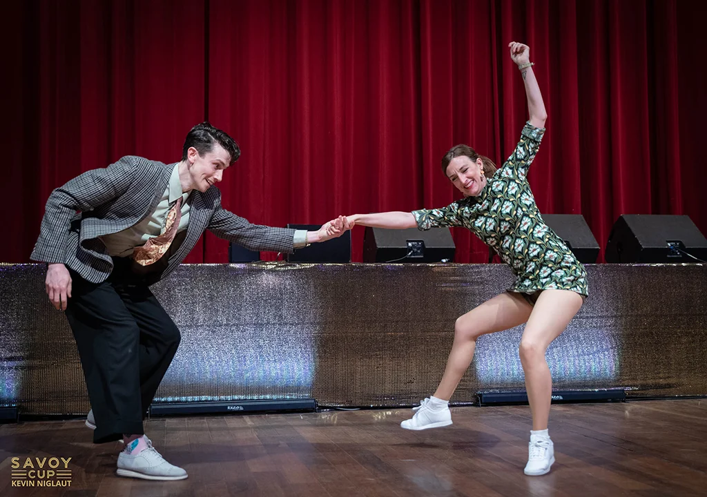

## Ari & Simon

{: .left}

We’re thrilled to welcome Ari & Simon back to our festival. Inviting them for the third time demonstrates just how much we love them. Their lessons are playful and challenging, and what you learn gives you plenty to think about and practice for a long time.\\
We’re incredibly grateful for the choreography they created for us to the song “Dominick Swing.” It’s become our “What’s Hop” dance routine, which we dance together at socials and parties.

Read below how they introduce themselves on their website:

“Ari and Simon are primarily focused on Lindy Hop and Authentic Jazz. They are passionate about these dance forms, especially in the context of their cultural traditions, their values and their place as an art form.\\
Working together since 2016, they are now based in Madrid working globally as well as growing their online platform through Patreon.\\
They are an energetic and rhythmical couple who love the interplay between the individual, the music and the partner during a dance and how it can develop into a beautiful conversation.\\
They hold titles from the International Lindy Hop Championships, The Savoy Cup and The Korean Lindy Hop Championships, among others. Their passion for the dance and the culture of swing has grown with them and is something they constantly strive to develop and express, whether in classes, on stage or in competition.”

Source: [About Us](https://ariandsimon.com/)
