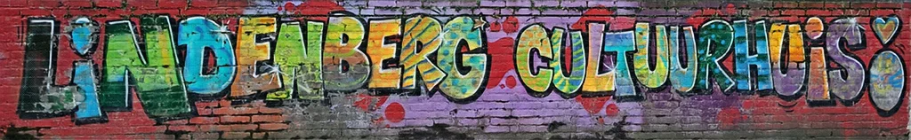
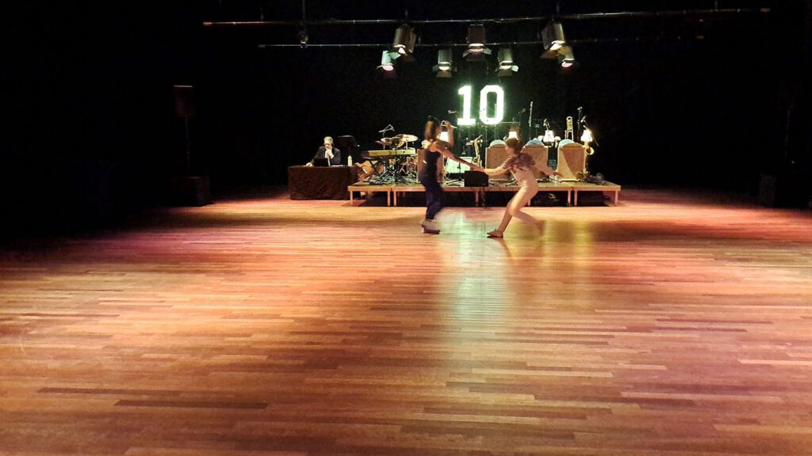
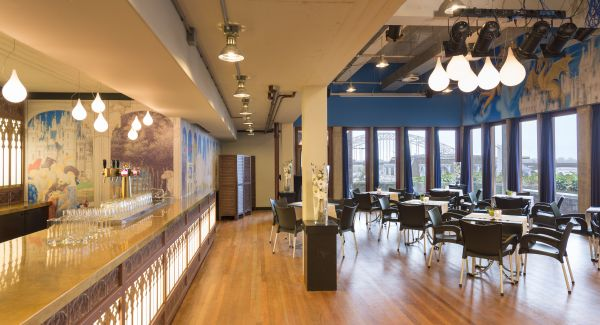

Cultuurhuis Lindenberg is a cultural center located in Nijmegen, Netherlands. It offers a variety of cultural activities, including theater performances, music concerts, dance classes, and art exhibitions. The center is also home to a number of cultural organizations, such as the Nijmegen Film Festival and the Lindenberg Theater. A restaurant and a cafe is also part of the venue.

The venue is located in walking distance of the Centraal Station Nijmegen, about a 10-15 min walk.\\
You can rent a bike at the station if you like.\\
Another possibility is taking the bus. Nearby busstops are “Voerweg” and “Valkhof”. See website of “9292.nl”\\
[Startpoint Central Station Nijmegen](https://9292.nl/en/station-nijmegen)

In the vicinity of the Lindenberg are several parking garages: Parkeergarage Kelfkensbos & Parkeergarage Eiermarkt. See the map.\\
[Map of parking garages in Nijmegen](https://www.nijmegen.nl/diensten/parkeren-verkeer-en-vervoer/parkeergarages/)

**NB.** From November 2025 to July 2026, work will take place near the Lindenberg as part of the redevelopment of the Kelfkensbos square. It is possible that it has impact on the situation of traffic or public transportation. Be alert to that. For the latest changes see: [Update Kelfkensbos](https://van-kessel.apps.debouw.app/projects/herinrichting-plein-kelfkensbos)

{: .half} {: .half}

Lindenbergzaal: Friday & Saturday — Valkhofzaal: Sunday
