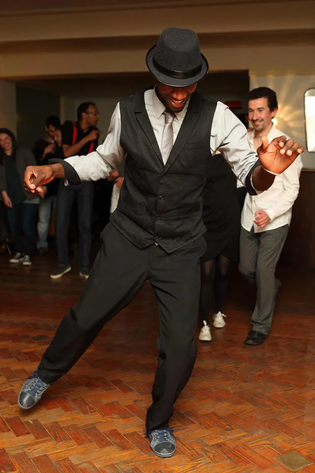

## Edmilson Botelho

We know Edmilson from the amazing workshops he gave in Nijmegen and his visits to our socials. We are very excited about his collaboration with Trisha and we are looking forward to it.

{: .left}

**Bio:**\\
“Born and raised on the islands of São Tomé and Príncipe, Edmilson Botelho has always been immersed in music, drawing inspiration from the vibrant rhythms of African traditional dances such as Usôa, Puíta, Funaná, Cadence, Kizomba, Semba, Kuduro, and many other African styles, as well as POP dance.

His dance journey began at the age of 17 when he moved to Porto, Portugal, and discovered his passion for Lindy Hop and Blues Dance. His dedication to the art of dance eventually led him to become one of managing at Hop Dance Studio in Porto, where he shares his love for movement and rhythm with others.

As a passionate dancer and teacher, Edmilson embodies the spirit of dance, finding joy in every step and rhythm. With his captivating energy and charismatic personality, he creates an atmosphere of fun and humility wherever he goes, inspiring others to feel the rhythm and express themselves through movement.”

source: [about me](https://botelhoedmilson.wixsite.com/edmilsonbotelho/about-me)
