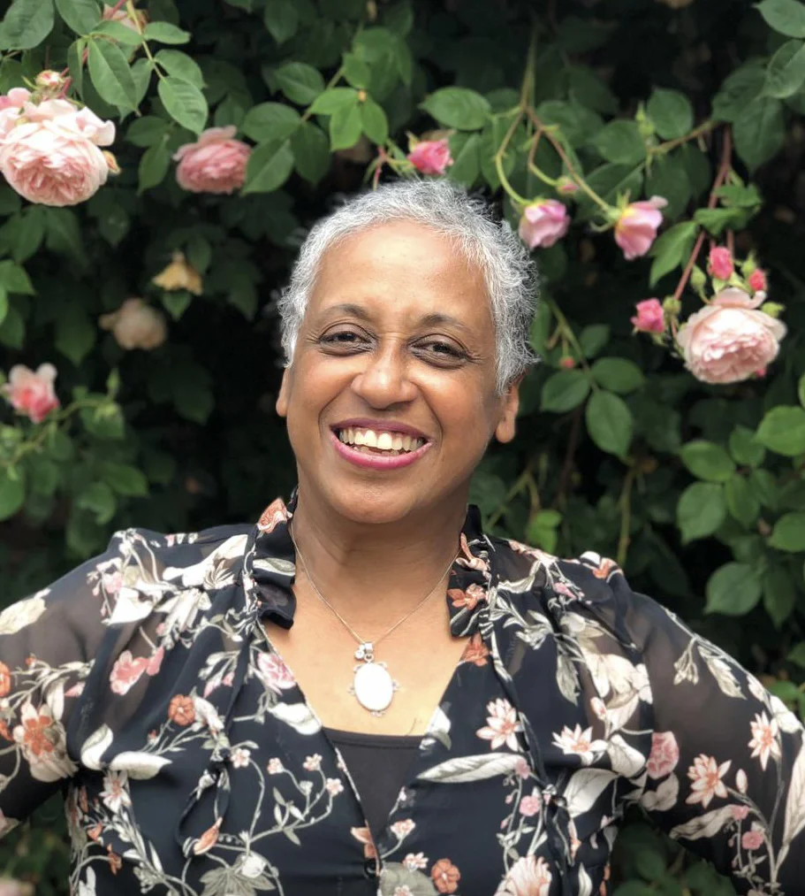

## Farida Nabibaks

Farida Nabibaks is the founder and artistic director of dance-theatre company Reframing HERstory Art Foundation in Arnhem.

{: .left}

Farida uses dance and embodied knowledge to address the collective trauma of the colonial and slavery past, with the ultimate goal of healing. She studied Philosophy at the Radboud University Nijmegen and holds a MA in Philosophy of Behavioural Sciences. She was also co-researcher in the Radboud Institute for the Culture and History (RICH) researchproject ‘Feeling the traces of the colonial past’, led by professor Liedeke Plate. This was built around her performance Radiant Shadow, part one, Margaretha.

Farida is a researcher at KITLV doing a practice-based research on healing from the colonial and slavery past through art, dance/ dance-theatre and embodied knowledge from multiple ethnic perspectives.

### What's Hop!?

Reframing HERstory Art Foundation offers dance-theatre performances, workshops and lectures to raise awareness on the colonial and slavery past of the Netherlands and its afterlives in present-day Dutch society. For What’s Hop!? the Foundation will bring following extended program:

* **Lecture** on Friday evening (by Farida Nabibaks, for all)\\
  The Lecture is titled: “**The Influence of African Culture on American Vernacular Dances**” and dives into the history of American and European social and pop-cultural dances and traditions. It will bring an insightful overview of history starting from taking a different perspective.
* **Theater Performance** on Saturday morning (by Reframing HERstory Art Foundation, limited seats)\\
  The dance-theatre performance “**ANNA, Radiant Shadow II**”, is a non-spoken embodied historical experience.
* **Workshop** on Saturday afternoon (by Farida and two members of Reframing HERstory, elective workshop)\\
  A guided movement workshop “**Move your Story**” that is based on embodiment and healing. We will touch upon themes of the performance in an embodied way as part of the Radiant Shadow experience. No particular dance training is required to be able to participate; we will be tapping into our innate creativity.\\
  (Clothing: Please wear comfortable clothes in which you can move easily. It might be a good idea to bring a warm sweater and socks.)
