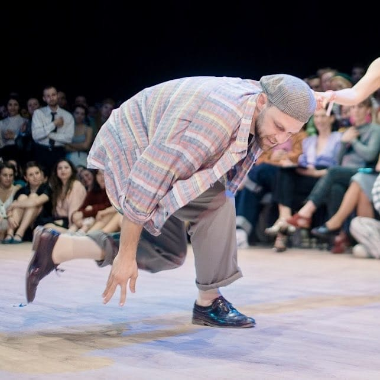

## Jonathan

We are honoured to welcome Jonathan from Saarbrücken. Being our DeeJee he will curate our parties on Saturday with an electrifying journey through the golden age of swing music.\\
Whether you’re a seasoned swinger, a total beginner, or just looking to cut a rug, Jonathan knows exactly how to read the room and drop the perfect track to fuel your body. Expect everything from classic Basie, Duke, and Ella to rare, driving gems that will make you want to jump, jive, and wail!

{: .left}

“Jonathan grew up with music and already as a teeny he had a passion for jazz, even if his peers couldn’t do anything with Art Tatum or Erroll Garner. As a piano player he is fascinated by jazz improvisation and listens mainly to artists from the 40/50s.

Many years later he discovered by chance that there was a Lindy Hop scene in his student town Saarbrücken (Germany). Couple dancing was very unfamiliar at first, but Jonathan quickly became an active social dancer and also DJ at local events.

10 years later, he‘s still around at festivals as a teacher, performer and DJ.”

source: Jonathan
