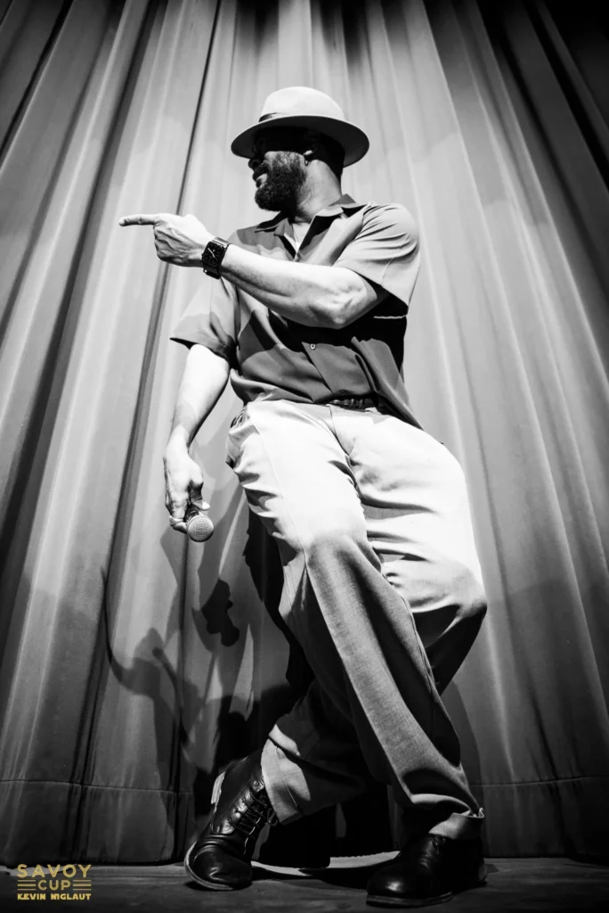

## JoYsS

{: .left}

“**Jean-Charles Zambo** is a multidisciplinary artist whose career was initially marked by a deep relationship with the art of dance, before blossoming into acting in film, television, and theater.

On stage, Jean-Charles is currently a member of the company In Luméa, where he is preparing Origine(s), an ambitious creation whose premiere is scheduled for October 2025.

An accomplished dancer, he received the 1st SACD Beaumarchais prize in 2007 for the choreography and musical creation of Apparence(s). In competition, he won first place in the ILHC World Championship in Solo Jazz.

Now known as **JoYsS**, he has become one of the key figures on the international swing scene, traveling the world to share his passion during workshops, masterclasses and as a master of ceremonies.”

source: lyonswingfestival.com

View a video of him with Ron Dobrovski. Funny encounter at a bus stop, crazy skills!
