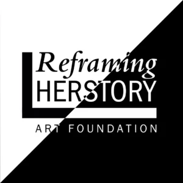
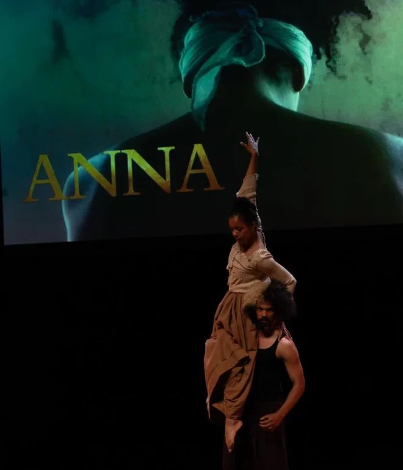

## ANNA, Radiant Shadow 2

The team of What’s Hop!? Is honoured to present Reframing HERstory Art Foundation’s Radiant shadow (Schitterende Schaduw) – a three-part music- and dance theater production based on traces of colonial and slavery past of 18th Century Gelderland and the Netherlands. Radiant shadow dives into the colonial history of the Province of Gelderland and its current reverberations in a truly capturing manner. You are warmly invited to come and join the second part of this series, titled ANNA.

Due to the size of the theater, no more than 130 people can attend the performance. We ask people to indicate their interest by purchasing a ticket via the registration form. We have been able to limit the price for this truly unique performance to 10 euros for our festival participants.\\
**When:** Saturday 10:30 am\\
**Where:** Lindenberg Cultuurhuis, Steigerzaal



ANNA is the second Radiant Shadow production, about a Black woman who lived in Arnhem in the 18 th Century. Little is known about her. What we do know is that she was born in slavery on the Vossenburg plantation in Suriname. The owner was a Dutchman from Arnhem. When he died, Anna accompanied his two daughters, almost her own age, from Suriname to their new home in Arnhem. Her life was spent in obscurity in the home of the Dutch family, but she must have been a spectacle being a Black woman. Who was she? How did she feel, and was she treated? Her world comes to life in our performance: ANNA.

{: .left style="width:200px"}

**Reframing HERstory Art Foundation**

Reframing HERstory Art Foundation, located in Arnhem, is the producer of the performance and workshop programme.

With this work the foundation contributes to raising awareness and bringing education about the colonial and slavery past of Gelderland to our audiences, working through history, heritage and ancestral connections towards healing from this past. The emphasis is on the urgency to bring the voices that were marginalized to the foreground and reflect on this history that is still present today.

Why this performance?

As a predominantly white festival community involved in a dance style that originated in Black culture, we feel it our duty to give participants the opportunity to explore the complicated history and its dynamics that are rooted in racial inequalities. In previous years, we have discussed the history of segregation in the USA, discovered the relation between Lindy Hop and Hip Hop and experienced the connection of Black Gospel and Jazz music.

This year we will explore this dynamic through an embodied experience, and we are happy to invite you to experience this very special and immersive performance programme.

What is the connection of ANNA and the history of Lindy Hop?

The origin of Lindy Hop and colonialism, slavery and racial inequalities are more connected than we might think, from a European perspective. Colonialism and slavery were set by European nations, who expanded their kingdoms or empires, and the racial inequalities that resulted from this have also shaped Dutch society. We think it important to explore the effect this had on society. ANNA is not only providing a unique perspective on history but also inviting you to experience its repercussions.

And what is the relation to dance itself?

In this performance, next to its historical content, dance is the main mode of communication. Dance as an artform, has the capacity to affect us beyond words, to express deep human emotions and feelings, that can resonate in all of us. The performance ANNA is a part of an immersive lived- experience. Prior to the performance is a short historical and embodied introduction. The performance is followed by a guided embodied reflection.

Duration of the whole programme is approximately 1,5 hours.

{: .right}

**Cast & Crew:**

Anna: Lana Renfrum\\
Dancers: Yara van Fraeijenhove, Rohiet Tjon Poen Gie, Melano Bruinhart\\
Singers: Fernando Linares-Correa (bariton), Saron Tesfahuney, Farida Nabibaks\\
Lutenist: Jasper Bärtling-Lippina\\
Composer: Jean Jacques Rojer\\
Acquisition/ Relations: Marita Bathoren\\
Production: Rina Penza Bernabela\\
Artistic Director: Farida Nabibaks\\
Costumes: in collaboration with @Gelderse Roos\\
Education programme: Saron Tesfahuney

Thanks to funders, donors and Friends of Reframing HERstory Art Foundation

*Fotografie: Jaap van Splunter*{: .caption}
