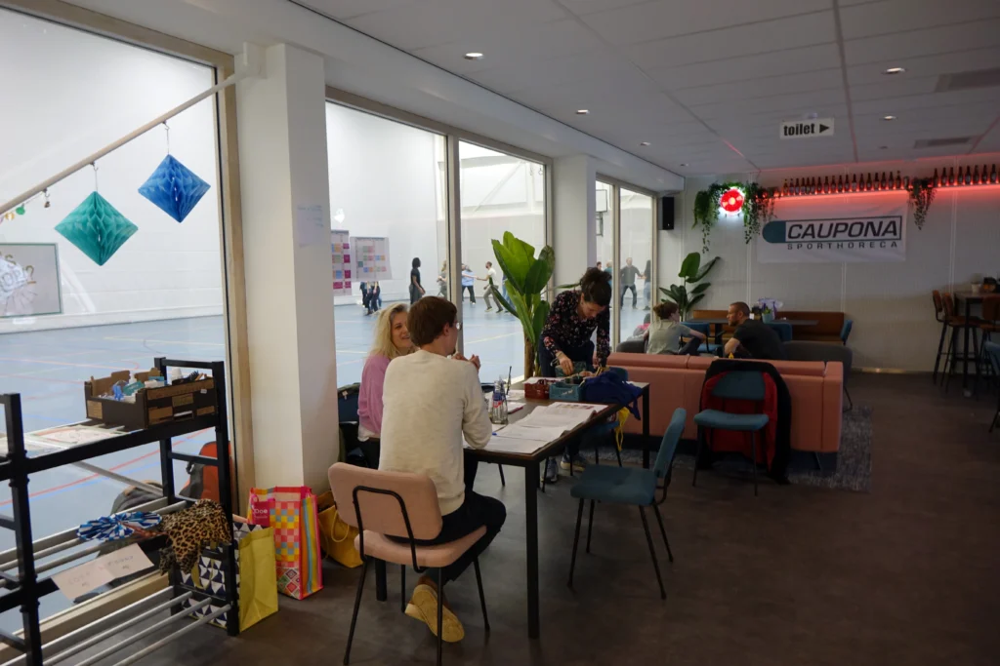
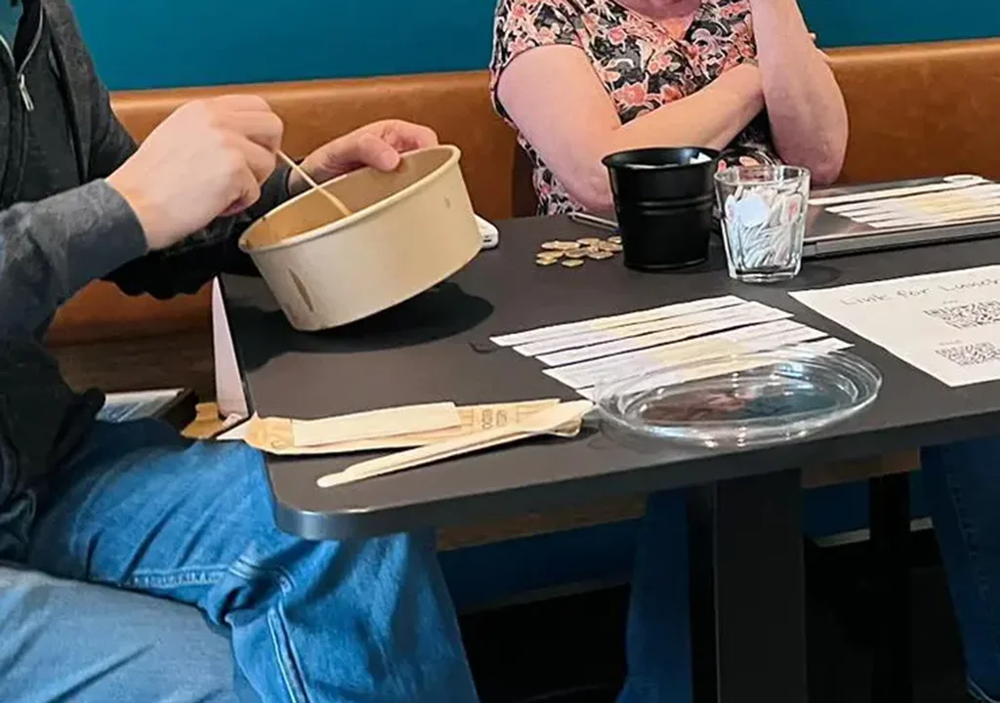
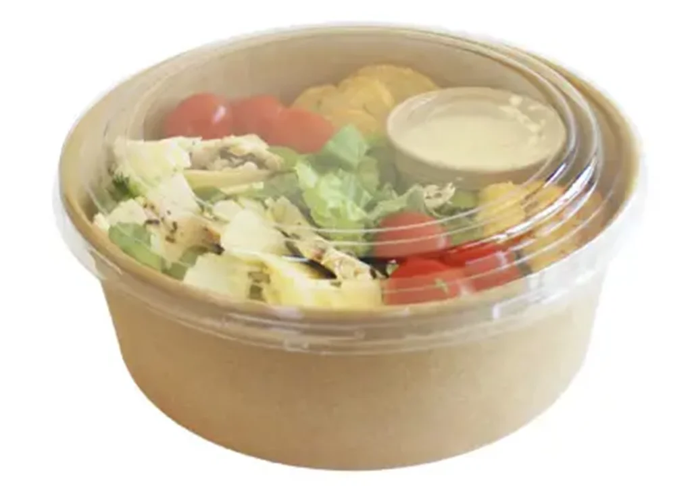

## Sporthal De Boog

{: .left}

**Sporthal De Boog** is a modern sports hall located in Nijmegen, Netherlands. The hall features a variety of sports facilities, including basketball courts, volleyball courts, and a handball court. It is also home to a spacious canteen that serves as a gathering place for athletes and visitors. The canteen offers a variety of food and drinks, including hot and cold beverages, snacks, and light meals.\\
**Address:** Dick Boerrigterplein 4, 6663 RC Lent

**Parking** at De Boog is not free. (You could park at De Triangel where parking is free and walk to De Boog, a 5 minute walk)

### Lunch Option

At De Boog we will hand out lunch boxes that you can order during the registration proces of the Full Festival Pass. Lunches are to be consumed at the canteen of De Boog.\\
Lunch is provided by the sports hall’s catering service: Caupona Sport Horeca.\\
Price = 12,50 euro per lunch.\\
Lunches are served on Saturday and Sunday, and you can choose between an Oriental and an Italian meal salad, both in different compositions.

**Oriental Meal Salad:**\\
Noodles, edamame, radish, mushrooms, spring onions, cashews, and sesame dressing.\\
Choice of:

* Ketjap Manis Chicken
* Soy-marinated Salmon
* Tofu (Vegan)

**Italian Meal Salad:**\\
Fusilli, cherry tomatoes, mozzarella, seed mix, basil, and olive oil.\\
Choice of:

* Pesto Chicken
* Italian-seasoned Salmon
* Vegan Chicken Strips (Vegan)

{: .half} {: .half}
