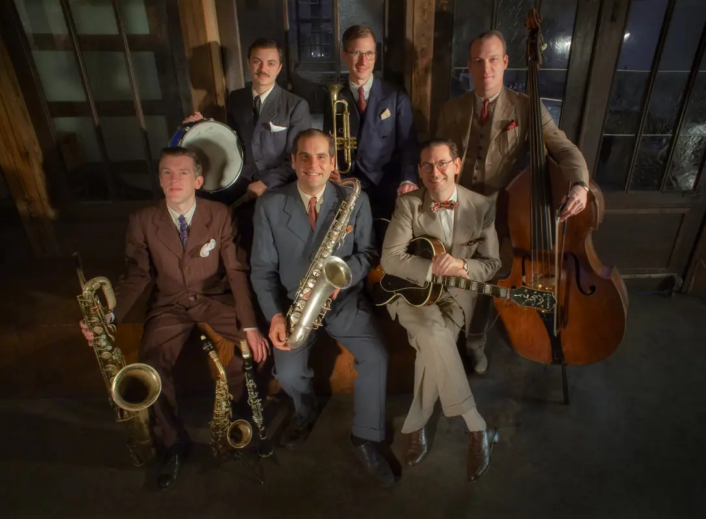

## The Big Five

Surprise! The Big Five comes with six musicians. A name change has not been considered, but we do expect more fun. For What’s Hop!? the band will feature with a special guest: the lovely [Elise Roth](/whats-hop/artists/elise-roth/).\\
That makes seven!

{: .left}

“Inspired by the wild hot sounds of 1930s/40s Harlem and Chicago jazz, The Big Five have established themselves as Berlin’s most authentic swing-era combo. Combining a driving rhythm section, a fiery horn-led frontline and dynamic song-arrangements, this international band makes a deep-dive into the lesser-known repertoire of the Swing “Golden Age” – as well as a strong emphasis on original compositions. Ranging in size from the core quintet to the full septet lineup.

The Big Five are veterans of Berlin’s famed Lindy-hop and Balboa dance-halls and know how to turn a mild-mannered dance party into a raging frenzy of swing-outs. With their sharp attire and an intense passion for authentic swing-era jazz, these cats will certainly make you Jump for Joy!”

Source: [thebigfiveswing](https://www.thebigfiveswing.com/)
