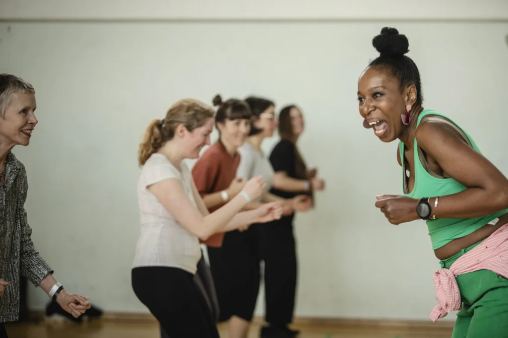

## Trisha Sewell

We are thrilled to announce the presence of an exceptionally seasoned instructor and dancer, Trisha Sewell, who has truly earned her stripes in the Lindy Hop scene. Her sparkling presence evokes enthusiasm and involvement. For the What’s Hop!? Festival she invited [Edmilson Botelho](/whats-hop/artists/edmilson-botelho/) to team up with her for the workshops.

{: .left}

**Bio:**\\
“Trisha hails from Hertfordshire, UK, and has been teaching since 1997 and on the international scene since 2003. For 10 years she contributed to establishing the first European swing dance brand and the biggest of its time. She is now thrilled to manage her own company SavoyHop.com creatively directed by her personal vision. Trisha has built up a reputation for being one of the most influential teachers within the European Swing Scene.

She has spearheaded the revival of Authentic Jazz within the UK, working and training with some of the freshest dancers and teachers around. It’s been said that her teaching style is innovative, dynamic and inspiring. Always engaging and fun, Trisha loves to make people laugh and feel relaxed in her classes. At the end of her classes students are filled with energy and excitement. Trisha ensures that class material is detailed and balanced for followers. The result is the dance looks as authentic as it can. Trisha’s ability to communicate complex concepts and patterns clearly means students find themselves easily understanding how movements and steps should look and feel.

Trisha has natural flair, a unique touch and very distinctive style on the dance floor. Her focus is to recreate the look of the original dancers of Lindy Hop, mixed with providing followers with drills, technique and musicality. An accomplished musician & experienced in Tap she helps others to understand rhythms and how to improvise within the dance. She has had formal training in Ballet, Contemporary, Jazz, Tap and musical theatre since the age 5.

With 12 years’ experience in Swing dancing teaching most of the popular dances such as Lindy Hop, Authentic Jazz, Blues, 20’s Charleston. Trisha is serious about Swing and helps you get where you want to go! With a vast experience in choreography and artistic direction, she leads the way with her exciting approach to performance. Not only has she choreographed countless routines, she has also performed in the world famous Royal Albert Hall in London. Trisha loves to play and listen to early Jazz and swing music and has an extensive music collection; don’t miss out on inviting her to DJ!

In addition to appearing in the TV, Newspapers, Radio and Music Videos, she has been regularly invited to perform and teach workshops at major dance events all over the UK and Europe, including Sweden, France, Spain, Germany, Greece, Norway, Turkey, Switzerland, Denmark, Belgium, Czech Republic, Hungary, Amsterdam, Italy, Austria, Ireland, Israel, Iceland and Slovenia.”

Source: [bio on website trishasewell.com](http://www.trishasewell.com/bio.html)
