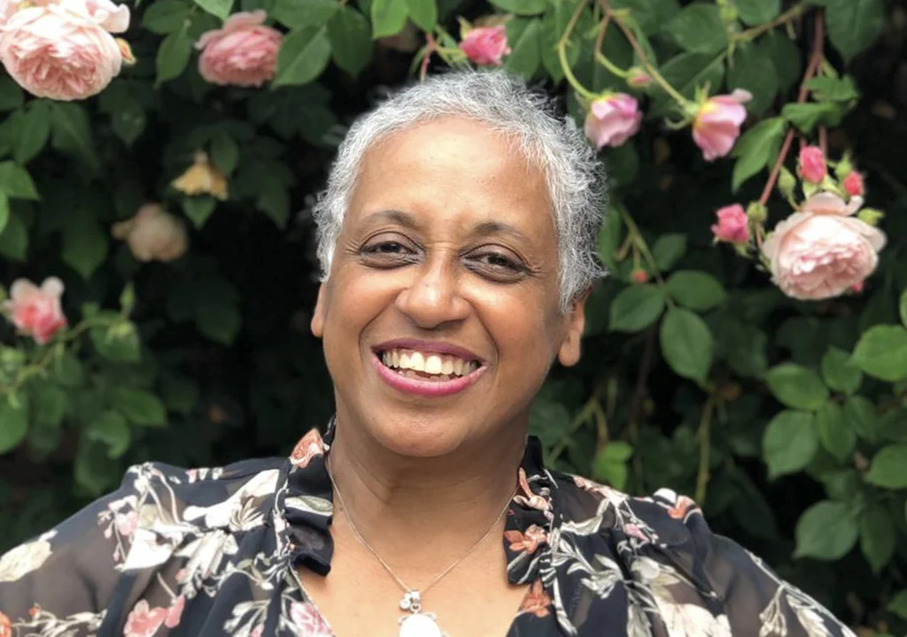
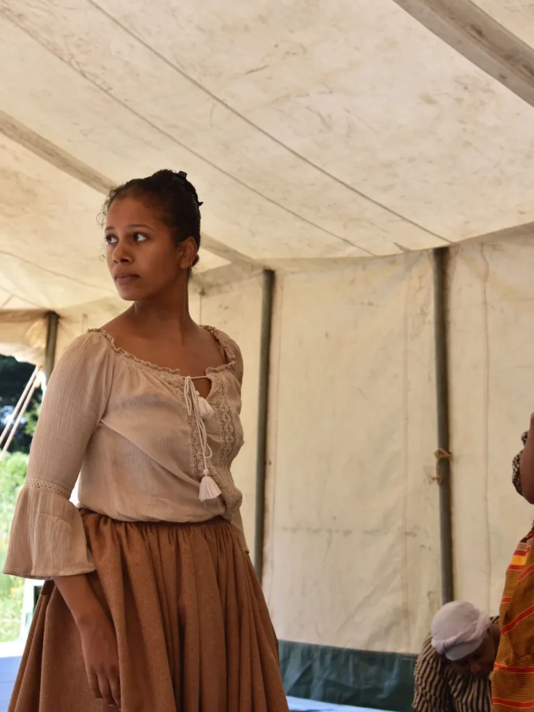
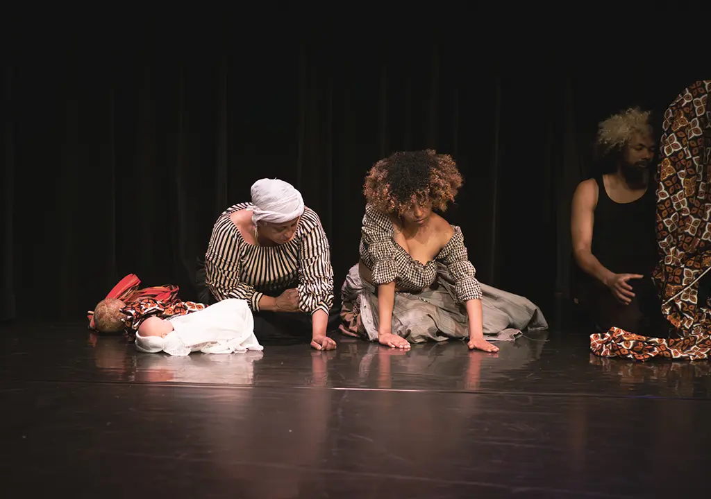
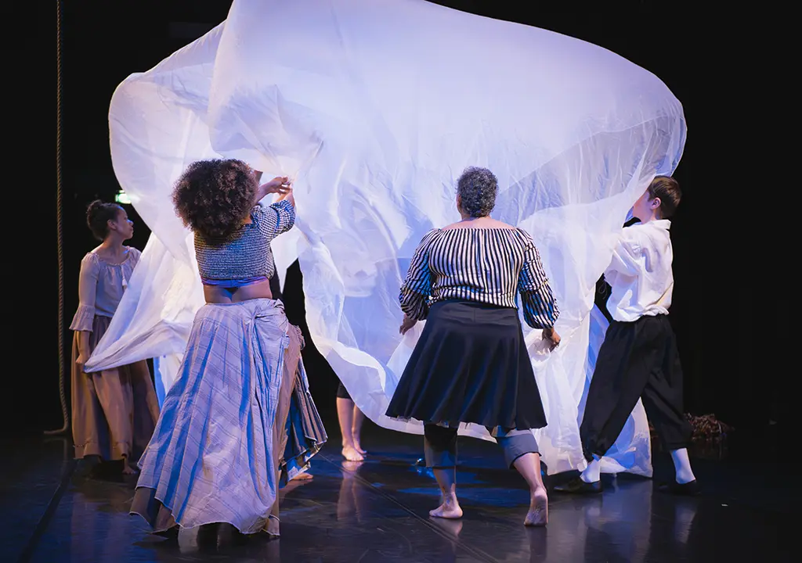

## Depth in Dance
{: .cream}

**Lecture – Performance – Workshop**

### Exploring Dance Through Thought, Body, and Practice

This year, we are very, very honoured and pleased to be working together with the local Reframing HERstory Art Foundation, and especially with the founder Farida Nabibaks. Farida and her fellow performers, artists, and creative souls will bring a depth to our festival that you have not experienced before.

### Lecture

{: .left}

On Friday night (13 February 2026), the programme made possible by Reframing HERstory Art Foundation will start with a lecture by [Farida Nabibaks](/whats-hop/artists/farida-nabibaks/), initiator, and artistic director of Reframing HERstory Art Foundation, also philosopher and embodiment researcher at KITLV, in Leiden.

The Lecture is titled: **“The Influence of African Culture on American Vernacular Dances”** and dives into the history of American and European social and pop-cultural dances and traditions. It will bring an insightful overview of history starting from taking a different perspective.

The lecture will start at 19:30 before the Friday party and is open to full pass and party pass participants of the festival.

### Performance

{: .right}

The second part, the dance-theatre performance ANNA, Radiant Shadow II, on Saturday 14 February at 10am in the morning.\\
ANNA is a non-spoken embodied historical experience about a Black woman who lived in Arnhem in the 18 th Century. Little is known about her. What we do know is that she was born in slavery on the Vossenburg plantation in Suriname. The owner was a Dutchman from Arnhem. When he died, Anna accompanied his two daughters, almost her own age, from Suriname to their new home in Arnhem. Her life was spent in obscurity in the home of the Dutch family, but she must have been a spectacle being a Black woman. Who was she? How did she feel, and was she treated? Read more about the performance and why it is part of What’s Hop!? 2026 here: [Reframing HERstory Art Foundation](/whats-hop/artists/reframing-herstory/)

**Cast & Crew:**

Anna: Lana Renfrum (see her on the picture)\\
Dancers: Yara van Fraeijenhove, Rohiet Tjon Poen Gie, Melano Bruinhart\\
Singers: Fernando Linares-Correa (bariton), Saron Tesfahuney, Farida Nabibaks\\
Lutenist: Jasper Bärtling-Lippina\\
Composer: Jean Jacques Rojer\\
Acquisition/ Relations: Marita Bathoren\\
Production: Rina Penza Bernabela\\
Artistic Director: Farida Nabibaks\\
Costumes: in collaboration with @Gelderse Roos\\
Education programme: Saron Tesfahuney

Thanks to funders, donors and Friends of Reframing HERstory Art Foundation

*Photography: Merel Tuitert*{: .caption}

***PLEASE NOTE***: this performance is open to the public, too! Do you have this one friend who is interested in the colonial past, heritage and healing? Or do you know another dancer, who might grow by diving into the depth of what dancing as embodied experience can mean? Invite them to join by buying a ticket below this page.

{: .half} {: .half}

*Photography: Mariëtte Kranenburg fotografie*{: .caption}

### Workshop

The guided workshop on Saturday 14 February is the third and final embodied exploration. We especially invite full pass participants to see this as a three-way package to understand, body and mind, our history and the ‘reality’ we live in. Full pass participants will be able to register for the workshop at the registration desk.

## Theater Tickets
{: .grey}



***PLEASE NOTE***: Are you not a participant of the festival, but you are coming to the performance and you would like to do the workshop (or lecture), too? Please reach out to us via: [whatshopnijmegen@gmail.com](mailto:whatshopnijmegen@gmail.com)
