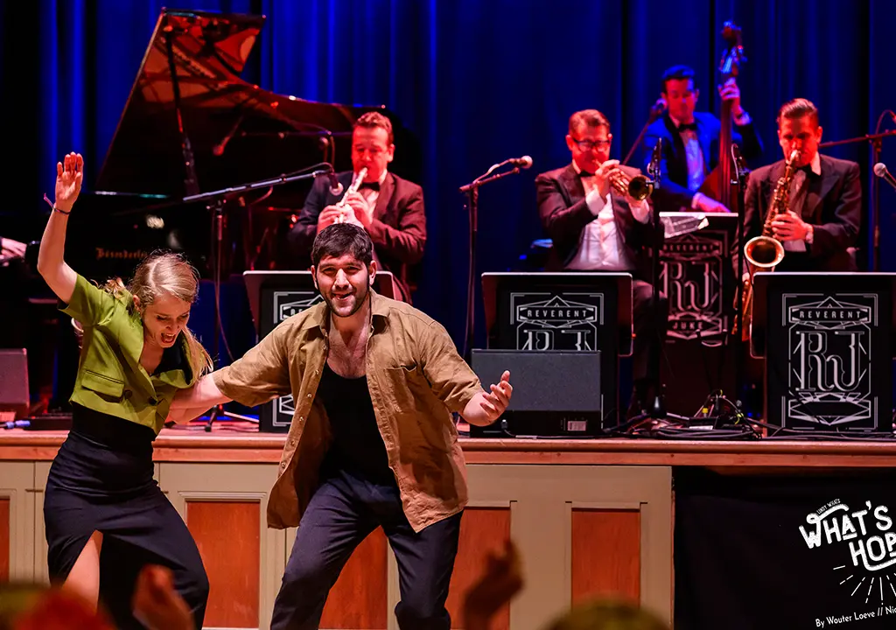
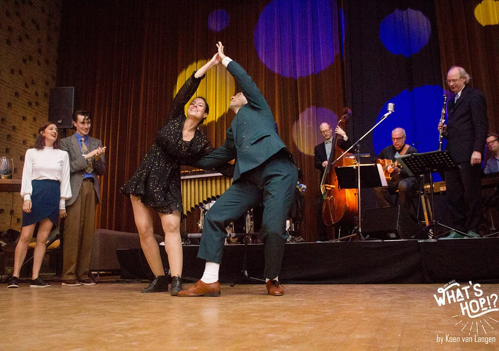

## February 13-15 2026
{: .grey}

{: .right}

**What's Hop!?**

Come dance with us in the oldest city of the Netherlands!

What’s Hop!? is a full weekend of parties with great bands and classes given by world-class teachers.

In particular, you can expect:

* Parties on Friday, Saturday and Sunday
* Classes in three different tracks with 6+ hours of workshops in lindy hop and solo jazz
* Some very special performances!

## Lineup of Artists
{: .grey}



## What's Hop!?
{: .white .silhouette}

{: .right}

What’s Hop!? has been happening in Nijmegen since 2019.

Our ambition was getting experienced teachers to come to Nijmegen and for us to connect to other dance communities. With each new edition it grew bigger and bigger!

Nevertheless, we keep to some core principles:

* Everyone – participants and artists alike – should feel welcome and respected.
* Everyone should feel safe in being a unique and beautiful person.
* We respect that swing dance descents from African and African-American roots and has a complicated history.
