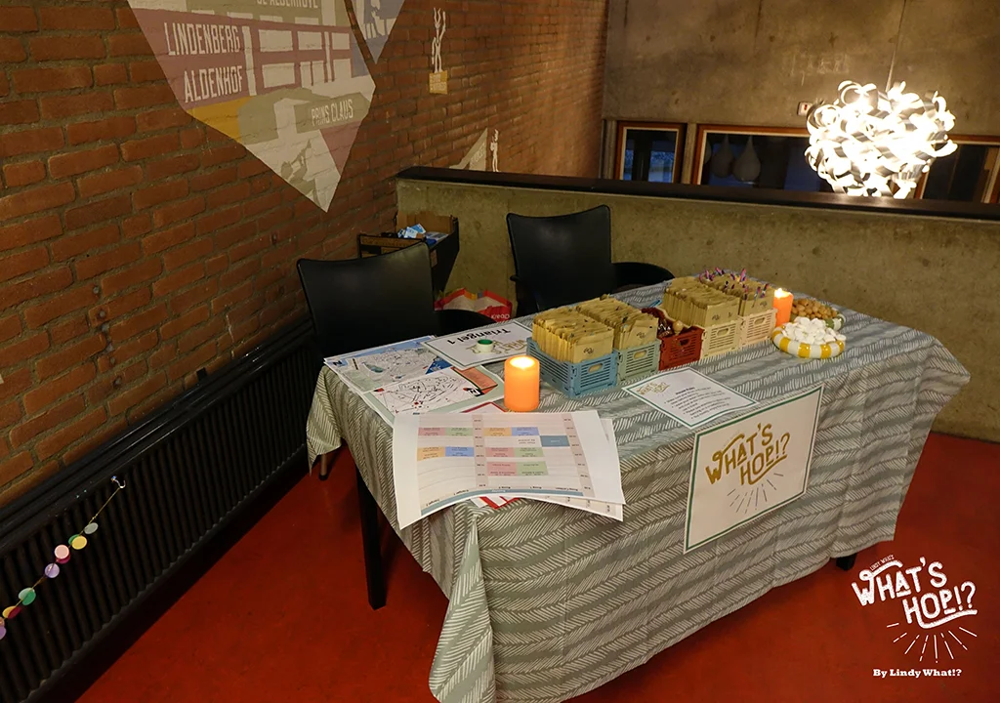
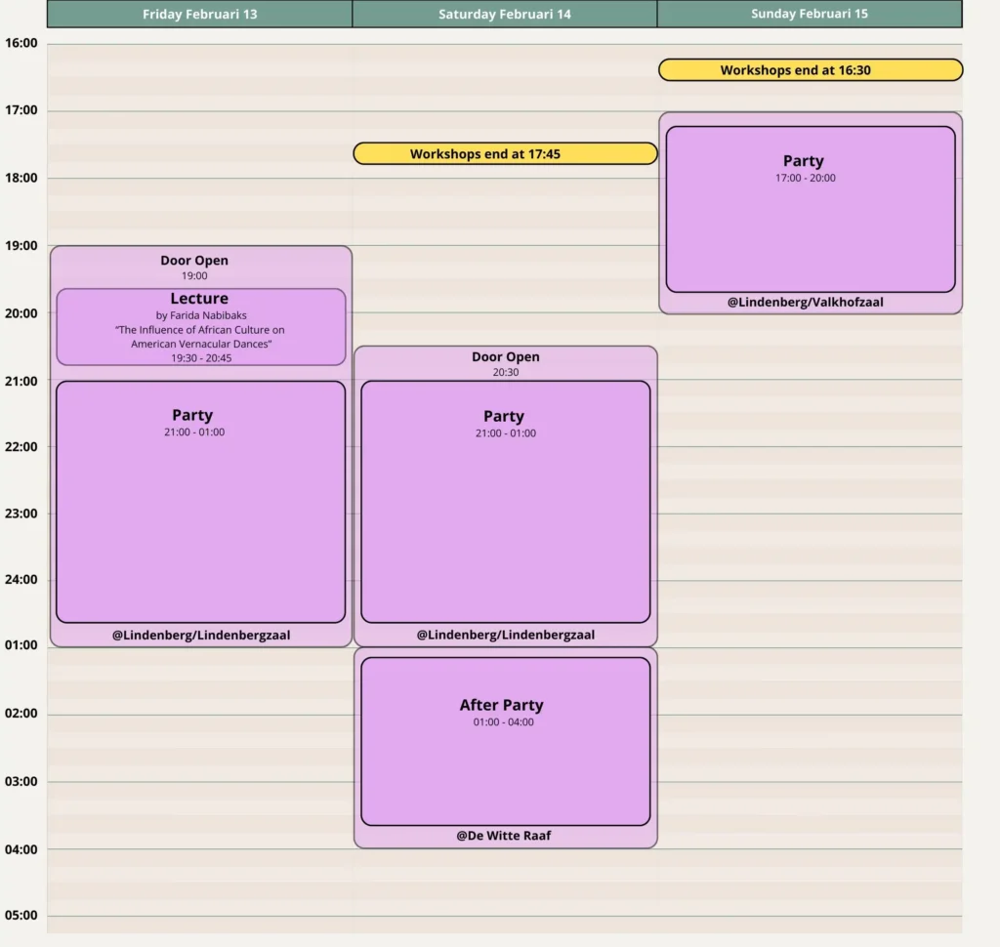

## Party Program
{: .cream}

Below the page you can find the schedule of the parties.

You will of course have plenty of opportunity to dance throughout the night, but we have also prepared some extra goodies for you sprinkled throughout the parties.

A more detailed outline of the parties will be announced soon.

## Reception
{: .grey}

{: .left}

There will be a reception desk present at the entrance.\\
Friday and Saturday the reception wil be open till 22:00. Friday you can confirm your registration at the reception desk. You will get an envelop with a bracelet matching your group and lunch vouchers if ordered.\\
If you’re there to just enjoy the party, your name will be checked via the guestlist.\\
The door will open 30 minutes before the start of the party.

Sunday at the Lindenberg the venue is open during the afternoon due to theater performance in one of the other halls. If you are early you can take a sip or a snack in their foyer.

## Party Schedule
{: .cream}

Below you can see an outline of the parties. It’s the latest version and probably the last.\\
However it can still be changed depending on unexpected developments or new insights.\\
**Note:** Saturday Party ends 01:00 am, After Party starts 01:00 am

