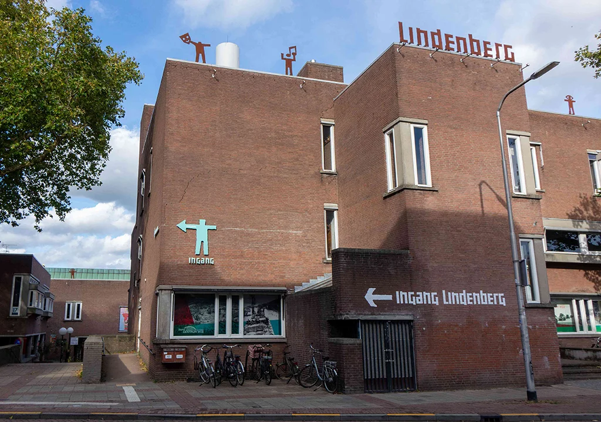
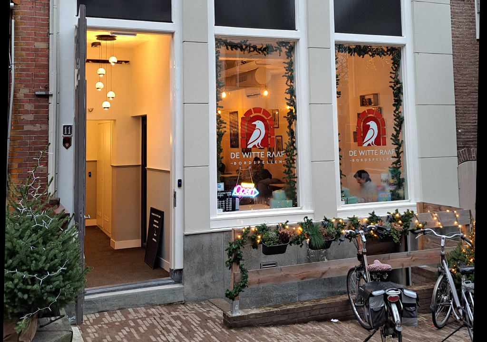

## Workshops
{: .grey}

If you joined us last year, then our venues should be quite familiar! We are very pleased to be back at **De Boog**, which will be our main workshop location as it was last year. De Boog is a newly built sports hall that offers a lot of space to dance, and as a big plus, it has a cosy canteen where we can have lunch together. It’s an excellent place to meet and relax between classes.\\
De Boog will be our base of operations during the workshops. You will find a registration and information desk at the entrance of the canteen. And if you ordered lunch with us during registration, you will be able to pick it up here.

**De Triangel** is our second workshop accomodation. It is located at a 5 minute walk from De Boog.

Both sport halls are located near train station ‘Nijmegen Lent’ (see the map below).

*All workshops will be in De Boog or De Triangel. There are dressing rooms and you can take a shower if you want. De Boog has a canteen where you can have a drink or a snack.*



**NB.** Click on the images for more info (address, parking, lunch options)

## Parties
{: .cream}

[{: .right}](/whats-hop/artists/de-lindenberg/)

All three parties this year will take place in **De Lindenberg**.

The Lindenberg is the foremost cultural center in Nijmegen. It has several halls for music and theater performances (which we will make maximal use of). There is also a restaurant and cafe if you want to rest a bit between all the dancing.

The Friday and Saturday parties will take place in the Lindenbergzaal. The sunday party will take place in the more cozy Valkhofzaal with a beautiful view on the Waal.

**NB.** Click on the image for more info.

{: .right}

Yes. This year there will be an afterparty following the Saturday party at **De Witte Raaf**. It’s just around the corner of De Lindenberg located between De Dollar and Nijmeegs Jopie in the Grotestraat 11.\\
Jonathan will bring the right tunes to bring you in the mood for a coozy night with a last dance and a tasty drop.\\
Entrance is included in Full Festival Pass, All Party Ticket, Saturday Party Ticket.

## Map
{: .grey}

You can find the venues on the map below.

* The blue pins mark the workshop locations.
* The purple pins mark the party venues.
* The black pins mark the trainstations.
* The yellow pin marks De Klinker.


