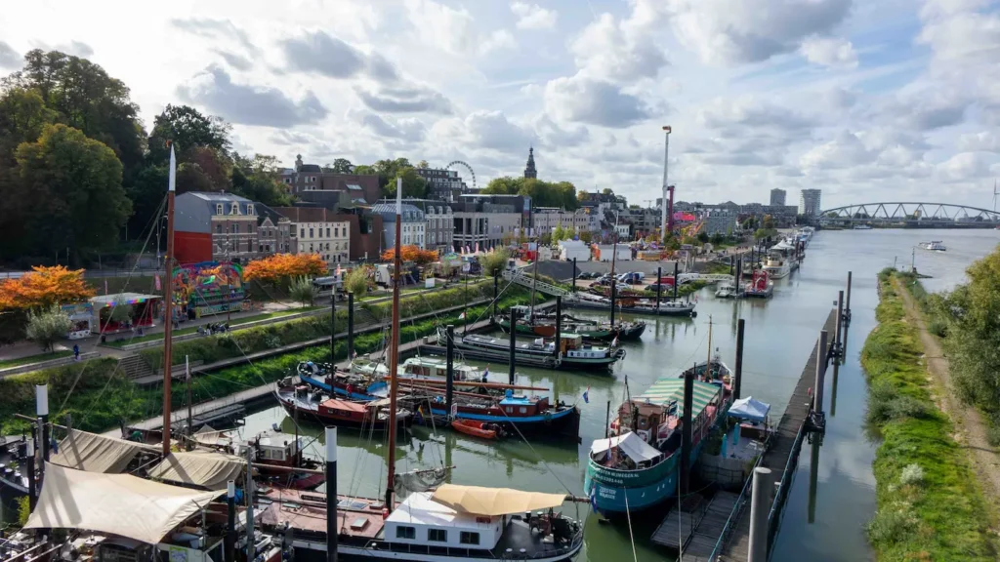
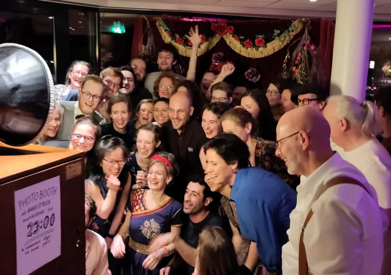

## Nijmegen (Nimma!?)
{: .grey}

{: .right}

The oldest city in the Netherlands. Once a Roman outpost, now an university town. “Old city, young vibe”.

Nowadays the city is best known for its International Four Day Marches (Vierdaagse) in the summer that attracts tens of thousands of participants.

And of course Nijmegen is getting more and more famous for What’s Hop!?

See: [into Nijmegen](https://en.intonijmegen.com/).

## Lindy What!?
{: .grey}

{: .left}

It all started in 2014 when six people hired a backstage room at a pub to give a Lindy Hop taster. Their credo was: “If you can’t find a Lindy Hop community in your city, why not create one yourself?”.\\
And because people hearing the name Lindy Hop often responded with a questioning “Lindy…What?”, the name of the community came naturally: “Lindy What!?”

Fast forwarding to the present: Lindy What!? has become a vibrant community driven by volunteers who have a passion for the swing era of jazz. People come to learn and dance Lindy Hop (and other swing dances) and to visit our socials not seldom with live music.\\
We enjoy one another’s company and have a good time dancing with everybody, no matter their skills.

## History of What's Hop!?
{: .cream}

Organizing the What’s Hop!? Festival has been a challenge but also a lot of fun.\\
Below you can take a walk through memory lane with some pictures and data points.


